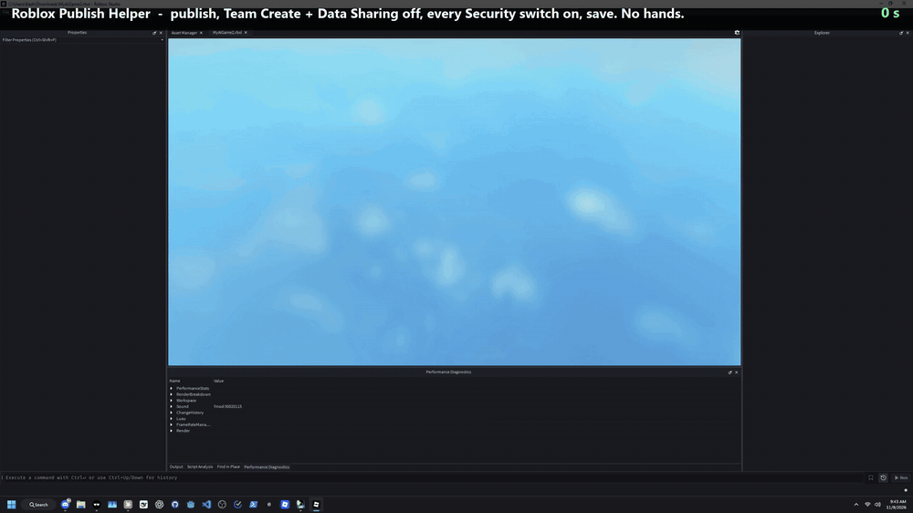

# Roblox Publish Helper

Publishes a Roblox place file from start to finish without you touching anything:



*2× speed. [Full-length video (real time, ~40 s)](docs/showcase.mp4)*

1. Opens the place in Roblox Studio (the newest one in your downloads folder, or the file you give it)
2. Waits until Studio has fully loaded (Play button ready, not just the window showing)
3. Opens the publish dialog (Alt+P), turns **off** every switch there (**Team Create**, **Data Sharing**), publishes
4. Closes the "Manage Audience" popup
5. Opens **File > Experience Settings > Security**, turns **every** switch **on**, saves

A full run takes about 35–40 seconds, most of it Studio loading and uploading. Built for quickly getting test places (for example ones built with Rojo) published as private experiences.

## Download

Grab `roblox-publish-helper.exe` from the [latest release](../../releases/latest). No install needed.

## Use

- **Double-click** the exe: publishes the newest `.rbxl`/`.rbxlx` in your places folder.
- **Right-click a place file > Open with > Roblox Publish Helper**: publishes that file.
- From a terminal: `roblox-publish-helper.exe path\to\MyGame.rbxl`

The first run asks three questions (press Enter to keep each default):

- the folder you download places to (default: your Downloads folder)
- the Roblox Studio exe to launch (default: always the newest installed version)
- whether to add the app to "Open with" for place files

While it runs:

| Key | What it does |
|---|---|
| **Esc** (or close its window) | Stop |
| **F8** | Skip the current step - if it's stuck and you did that part yourself |

It moves the mouse and clicks in Studio, so leave the mouse alone while it runs. If a step goes wrong (for example Studio wants you to log in first), its window comes back: press **Enter** to retry that step, or type **S** and Enter to skip it. A screenshot of Studio is saved as `last_failure.png` next to the exe - attach it if you report a problem. When publishing succeeds, the window closes by itself.

## Settings

Everything is in `config.json` next to the exe:

| Setting | What it does |
|---|---|
| `places_folder` | Where to look for the newest place (empty = Downloads) |
| `studio_path` | Studio exe to launch (empty = newest install) |
| `open_with` | Add to "Open with" for `.rbxl`/`.rbxlx` |
| `publish_turn_all_off` | Turn off every switch in the publish dialog (default `true`) |
| `publish_toggles` | Then force specific publish-dialog toggles by label, e.g. `{"Team Create": true}` |
| `security_turn_all_on` | Turn on every switch in Experience Settings > Security (default `true`) |
| `security_toggles` | Then force specific Security toggles by label, e.g. `{"Allow Third Party Sales": false}` |
| `search_start_delay` | Seconds to wait after a click before looking for the next button |
| `delay_before` | Extra wait before specific buttons, e.g. `{"save_button": 0.5}` |
| `poll_interval`, `step_timeout`, `toggle_timeout`, `publish_timeout`, `studio_load_timeout` | How often and how long it searches |
| `match_score` | How alike (0–1) the screen must be to a button image. Real matches score ~0.95+; lower slightly if buttons aren't found |

Toggle names are the label text shown in Studio. Forcing a toggle by label needs its image: add the label with `true`/`false`, then run `roblox-publish-helper.exe calibrate "Its Label"`.

Run `roblox-publish-helper.exe setup` to answer the first-run questions again. Upgrading from an older version? Delete `config.json` to get the new defaults.

## How it finds buttons

It looks for small reference images of each button on screen, only inside the Studio window (or the Studio dialog in front), and recognises dialogs by their window titles. Matching compares the pattern of light and dark, so a wallpaper-tinted or lighter/darker background doesn't throw it off. Built-in images come from Studio's **dark theme** and cover both the older UI and the November 2026 UI (some buttons have two images). They're resized automatically for Windows display scaling (125%, 150%, ...). If your setup still doesn't match, re-capture what's needed:

```
roblox-publish-helper.exe calibrate                 # everything
roblox-publish-helper.exe calibrate save_button     # just one
```

Calibration asks you to hover each item and captures it after a 5-second countdown. Your own captures are saved in `templates\` next to the exe and take priority over the built-in ones.

## Build from source

```
pip install pyautogui numpy pillow pyinstaller
python test_locate.py
pyinstaller --onefile --console --name roblox-publish-helper --exclude-module cv2 --exclude-module tkinter --exclude-module _tkinter --add-data "default_templates;default_templates" roblox_publish.py
```
